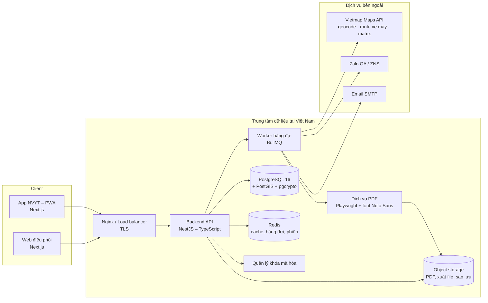
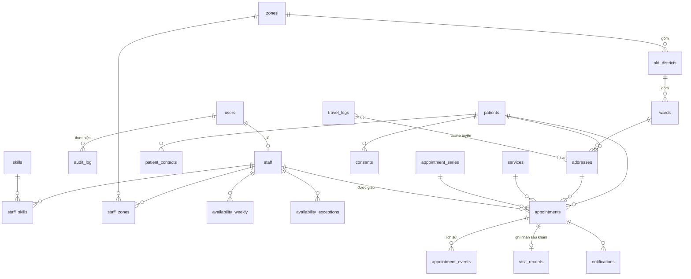

# Kế hoạch triển khai: Công cụ điều phối zone – Axel Homecare

> Phiên bản: 1.0 · Ngày lập: 19/11/2026 · Người phụ trách: Quản lý vận hành
> Nguồn yêu cầu: trang mẫu (prototype) “Công cụ điều phối zone - Axel Homecare” trên claude.ai (artifact `0837cc42-a8b0-45ef-82ae-db4c27d7e0f3`)

---

## 1. Mục tiêu

Chuyển trang mẫu đang chạy trên claude.ai thành **hệ thống web chính thức của phòng khám**:

1. **Tài khoản riêng cho từng người** (tên đăng nhập + mật khẩu + xác thực 2 lớp), không phụ thuộc tài khoản claude.ai.
2. **Cơ sở dữ liệu riêng của phòng khám**, đặt tại Việt Nam, có sao lưu, mã hóa dữ liệu sức khỏe và nhật ký không sửa được.
3. **Ứng dụng cho nhân viên y tế** (BS / ĐD / KTV): xem và xác nhận ca của chính mình, check-in/check-out, ghi nhận sau khám.
4. **Định tuyến xe máy thật**, tìm địa chỉ theo **địa giới hành chính mới** (sau 01/07/2025).
5. Giữ nguyên toàn bộ nghiệp vụ đã chốt trong trang mẫu (mục 3).

**Ngoài phạm vi giai đoạn này:** bệnh án điện tử đầy đủ (EMR), kết nối BHYT, kế toán / hóa đơn điện tử. Các phần này để dành cho giai đoạn sau và được thiết kế sẵn chỗ mở rộng.

---

## 2. Vì sao phải chuyển khỏi trang mẫu

| Hạn chế của trang mẫu | Hệ thống chính thức |
|---|---|
| Đăng nhập bằng tài khoản claude.ai; nhân viên y tế part-time khó dùng | Tài khoản riêng, có 2FA, khóa/mở tài khoản tức thì |
| Chỉ khóa được ở tầng dữ liệu cho “Nhân viên” và “Cài đặt”; còn lại khóa ở giao diện | Phân quyền ở máy chủ + Row-Level Security trong CSDL |
| Nhật ký mỗi người vẫn tự sửa được của chính mình | Nhật ký **append-only**, chống sửa bằng chuỗi băm |
| Dữ liệu nằm trên hạ tầng của bên thứ ba ở nước ngoài | CSDL đặt tại trung tâm dữ liệu ở Việt Nam |
| TomTom (qua connector) chỉ có chế độ ô tô | API bản đồ Việt Nam có chế độ **xe máy** |
| PDF dạng ảnh chụp, không chọn được chữ | PDF tạo ở máy chủ, font tiếng Việt chuẩn, chữ chọn được |
| Chỉ tải 70 ngày lịch gần nhất | Truy vấn toàn bộ lịch sử, có phân trang |

---

## 3. Phạm vi chức năng (chuyển từ trang mẫu)

### 3.1 Tiếp nhận & điều phối
- Tra khách cũ theo SĐT (chuẩn hóa 0/+84, bỏ dấu cách/chấm). Nhiều người bệnh dùng chung 1 SĐT thì cho chọn đúng người. Khách mới thì SĐT tự chép xuống “SĐT liên hệ chính”.
- **Phiếu tiếp nhận** – bắt buộc đủ mới giao ca:
  - A. Người bệnh: họ tên*, ngày sinh dd/mm/yyyy*, giới tính*, SĐT.
  - B. Liên hệ: họ tên*, quan hệ*, SĐT chính* (10 số), SĐT dự phòng.
  - C. Địa chỉ: tỉnh/TP*, phường/xã mới*, số nhà + tên đường* (1 ô), tòa nhà/căn hộ, tọa độ*.
  - D. Chuyên môn: dịch vụ*, lý do*, bệnh nền*, dị ứng* (nếu “Có” thì bắt buộc ghi chi tiết), vận động*, thuốc đang dùng, **y lệnh BS bắt buộc với truyền dịch / tiêm / đặt sonde**, vật tư.
  - E. Lịch hẹn*: ngày, giờ theo slot, thời lượng, loại nhân sự, kỹ năng, lặp lại (ngày/tuần, N buổi).
  - F. Thanh toán*: hình thức, chi phí dự kiến, phụ phí đi lại, lưu ý, xác nhận với khách*.
- **Định danh người bệnh = họ tên + ngày sinh**; cảnh báo khi trùng tên.
- Kết quả zone (trong/ngoài vùng 12 km, zone, km & phút xe máy, phụ phí) và **gợi ý nhân viên**:
  1. lọc loại nhân sự
  2. loại người trùng ca
  3. xuất phát từ ca trước (hoặc từ nhà)
  4. kịp giờ ca trước và ca sau (+ đệm 10 phút)
  5. đúng khung giờ làm, chưa vượt số ca tối đa, đủ kỹ năng
  6. ưu tiên người phụ trách đúng zone
  7. ít phút di chuyển nhất
- Giao ca, lưu ca chưa giao, tin nhắn giao ca, phiếu giao ca PDF.

### 3.2 Zone (cụm quận) & kiểm tra khu vực
- 8 zone mặc định (chỉnh được):

  | Zone | Quận cũ |
  |---|---|
  | Zone 1 Chợ Lớn | Q.5, Q.10, Q.11 |
  | Zone 2 Trung tâm | Q.1, Q.3, Q.4 |
  | Zone 3 Tây Nam | Q.6, Q.8, Bình Chánh |
  | Zone 4 Tây | Bình Tân, Tân Phú |
  | Zone 5 Bắc | Tân Bình, Phú Nhuận, Gò Vấp |
  | Zone 6 Đông Bắc | Bình Thạnh, Q.2 cũ, Thủ Đức, Q.9 |
  | Zone 7 Nam | Q.7, Nhà Bè, Cần Giờ |
  | Zone 8 Bắc xa | Q.12, Hóc Môn, Củ Chi |

- Ca được gán zone theo **phường/xã mới → quận cũ → zone**. Hệ thống chính thức lưu **ranh giới phường dạng đa giác** (PostGIS) để gán theo tọa độ khi thiếu phường.
- Ô kiểm tra nhanh địa chỉ; bản đồ tô màu theo zone.

### 3.3 Lịch & nhân sự
- Giờ phòng khám 07:00–17:00. Slot: BS 90 phút, ĐD 60 phút, KTV 60 phút.
- Nhân viên **Full-time**: nghỉ trưa 1 giờ, nghỉ 1 ngày/tuần. Nhân viên **Part-time**: nhiều khung giờ cho mỗi thứ trong tuần. Có lịch riêng theo ngày (nghỉ, chỉ rảnh khung…, làm đủ giờ).
- Kỹ năng chọn bằng checkbox theo BS / ĐD / KTV; mỗi người chọn zone phụ trách.
- Tổng quan lịch: Ngày (lưới nhân viên × slot), Tuần (lịch dạng cột: ngày × khung giờ), Tháng (slot trống, tỉ lệ lấp đầy). Lộ trình theo ngày.

### 3.4 Khách hàng
- Danh bạ (SĐT che một phần); hồ sơ chi tiết; lịch hẹn sắp tới; lịch sử đặt hẹn; lịch sử chỉnh sửa.

### 3.5 Quản trị & bảo mật
- Vai trò, nhật ký thao tác, che SĐT, hủy ca bắt buộc lý do, khóa ca đã hoàn thành, xuất Excel/PDF có ghi nhật ký.
- Giao diện song ngữ VI/EN (bộ từ điển i18n chuẩn, không dựa vào trình duyệt tự dịch).

### 3.6 Mới so với trang mẫu
- **App nhân viên y tế** (web dạng PWA, cài như ứng dụng trên điện thoại): xem ca của mình, xác nhận/từ chối ca, nút gọi khách, chỉ đường, check-in/out có GPS, ghi sinh hiệu và nội dung thực hiện. Phần ghi nhận này thay cho phần ghi tay trên phiếu PDF.
- **Gửi phiếu giao ca qua Zalo OA (ZNS)** thay cho copy/dán tay.
- **Quản lý sự đồng ý** của khách về xử lý dữ liệu cá nhân (xem mục 6).
- **Báo cáo:** số ca theo zone/dịch vụ/nhân viên, tỉ lệ lấp đầy, km di chuyển, tỉ lệ hủy.

---

## 4. Kiến trúc đề xuất



**Nguyên tắc:**
- Dữ liệu cá nhân và dữ liệu sức khỏe **chỉ lưu tại Việt Nam**.
- Gọi dịch vụ bản đồ chỉ gửi tọa độ hoặc địa chỉ, **không gửi** tên hay thông tin sức khỏe.
- Mọi thao tác đọc/ghi dữ liệu nhạy cảm đi qua API và được ghi nhật ký.

---

## 5. Lựa chọn công nghệ

| Thành phần | Đề xuất | Lý do |
|---|---|---|
| Frontend | **Next.js 15 + TypeScript + Tailwind**, i18n bằng `next-intl` (VI/EN) | Một codebase cho web điều phối và PWA nhân viên |
| Backend | **NestJS (TypeScript)**, REST + OpenAPI | Phân lớp rõ, có sẵn guard phân quyền, dễ kiểm thử |
| Cơ sở dữ liệu | **PostgreSQL 16 + PostGIS + pgcrypto** | Quan hệ chặt chẽ (ca, lịch, hồ sơ); PostGIS cho ranh giới phường/zone và truy vấn khoảng cách; Row-Level Security; mã hóa cột |
| ORM / migration | Prisma (hoặc Drizzle) + SQL migration thủ công cho PostGIS/RLS | Quản lý thay đổi schema có version |
| Cache / hàng đợi | **Redis 7 + BullMQ** | Cache kết quả định tuyến; job gửi Zalo, tạo PDF, xuất Excel |
| Bản đồ | **Vietmap Maps API** (chính), TomTom / Google (dự phòng) | Có hồ sơ **xe máy**, có Matrix API, dữ liệu theo địa giới mới (xem dưới bảng) |
| Bản đồ hiển thị | MapLibre GL + tile Vietmap | Vẽ ranh giới zone thật, điểm ca, tuyến đường |
| PDF | Playwright (Chromium headless) + font **Noto Sans / Be Vietnam Pro** nhúng | Tiếng Việt chuẩn, chữ chọn được, in A4 đẹp |
| Excel | `exceljs` | Định dạng cột, bộ lọc, nhiều sheet |
| Xác thực | Tự xây: **Argon2id** + **TOTP 2FA** + phiên httpOnly; hoặc **Keycloak** tự host | Không phụ thuộc bên ngoài; khóa tài khoản ngay khi nghỉ việc |
| Thông báo | Zalo OA – ZNS (mẫu tin đã duyệt), email | Nhân viên y tế dùng Zalo hằng ngày |
| Hạ tầng | Docker + Docker Compose (giai đoạn đầu) → Kubernetes khi cần | Đơn giản, dễ chuyển nhà cung cấp |
| Hosting | **Cloud trong nước**: Viettel Cloud / FPT Cloud / VNPT Cloud / CMC Cloud | Dữ liệu ở Việt Nam, giảm nghĩa vụ chuyển dữ liệu xuyên biên giới |
| Giám sát | Sentry (lỗi), Uptime Kuma, Grafana + Loki (log), pg_stat_statements | Phát hiện sự cố sớm |
| CI/CD | GitHub Actions → build image → deploy staging → duyệt → production | Mỗi bản phát hành có kiểm thử tự động |

**Vì sao chọn Vietmap:**
- Tham số routing nhận các giá trị `car`, `bike`, `foot`, `motorcycle`.
- Có Matrix API tính ma trận N×M quãng đường/thời gian trong một lần gọi. Phù hợp bài toán “1 ca mới × N nhân viên”, nhanh hơn nhiều so với gọi Route N×M lần.
- Hỗ trợ tìm địa chỉ theo địa giới sau 01/07/2025 và chuyển đổi địa chỉ cũ ↔ mới.
- Nguồn: tài liệu Vietmap Maps API (maps.vietmap.vn/docs).
- Cần ký hợp đồng và lấy báo giá theo số lượt gọi trước khi chốt.

---

## 6. Bảo mật & tuân thủ pháp luật

### 6.1 Căn cứ
- **Luật Bảo vệ dữ liệu cá nhân số 91/2025/QH15**, hiệu lực 01/01/2026. Luật có điều riêng (Điều 26) về dữ liệu **thông tin sức khỏe**, và quy định về **đánh giá tác động xử lý dữ liệu cá nhân (DPIA)** cùng **đánh giá tác động chuyển dữ liệu xuyên biên giới (CTIA)**.
- **Nghị định 356/2025/NĐ-CP** hướng dẫn luật trên: xếp **tình trạng sức khỏe** vào nhóm dữ liệu cá nhân nhạy cảm; có quy định về hồ sơ DPIA và CTIA.
- Luật Khám bệnh, chữa bệnh và các quy định về lưu trữ hồ sơ khám chữa bệnh. Thời hạn lưu trữ cần được **luật sư / pháp chế xác nhận** trước khi cấu hình chính sách xóa dữ liệu.

> ⚠ Phần pháp lý trong kế hoạch này mang tính định hướng kỹ thuật, không thay cho tư vấn pháp lý. Cần luật sư rà soát trước khi vận hành chính thức.

### 6.2 Việc cần làm về tuân thủ
| # | Việc | Phụ trách |
|---|---|---|
| 1 | Chỉ định người/bộ phận phụ trách bảo vệ dữ liệu cá nhân | Ban giám đốc |
| 2 | Lập **hồ sơ DPIA** cho hoạt động xử lý dữ liệu khách hàng và nhân viên | Vận hành + pháp chế |
| 3 | Nếu dùng bất kỳ dịch vụ đặt máy chủ ở nước ngoài có nhận dữ liệu cá nhân thì lập **hồ sơ CTIA**. Đặt hạ tầng tại VN và chỉ gửi tọa độ cho dịch vụ bản đồ giúp giảm phạm vi phải đánh giá | Pháp chế |
| 4 | Mẫu **đồng ý xử lý dữ liệu** (nhất là dữ liệu sức khỏe), lưu bằng chứng đồng ý trong hệ thống (bảng `consents`) | Vận hành |
| 5 | Quy trình xử lý yêu cầu của khách: xem, sửa, xóa, rút lại đồng ý | Vận hành |
| 6 | Quy trình **thông báo khi lộ lọt dữ liệu**: phát hiện → khoanh vùng → báo cơ quan có thẩm quyền theo thời hạn luật định → báo khách | IT + Ban giám đốc |
| 7 | Hợp đồng xử lý dữ liệu (DPA) với nhà cung cấp cloud, bản đồ, Zalo | Pháp chế |

### 6.3 Biện pháp kỹ thuật
- **Xác thực:**
  - Mật khẩu băm Argon2id, tối thiểu 10 ký tự.
  - **2FA bắt buộc** cho Quản lý và Điều phối.
  - Khóa tài khoản sau 5 lần đăng nhập sai.
  - Hết phiên sau 30 phút không thao tác.
- **Phân quyền** (RBAC) kiểm tra ở API, kèm **Row-Level Security** trong PostgreSQL: nhân viên y tế chỉ đọc được ca và hồ sơ người bệnh của ca mình được giao, trong khoảng ±24 giờ quanh giờ hẹn.
- **Mã hóa:**
  - TLS 1.2+ cho mọi kết nối; ổ đĩa mã hóa.
  - Các cột nhạy cảm (bệnh nền, dị ứng, thuốc, y lệnh, lý do khám) mã hóa ở tầng ứng dụng (AES-256-GCM, khóa trong KMS / Vault, xoay khóa hằng năm).
  - SĐT lưu thêm bản băm để tra cứu mà không cần giải mã.
- **Nhật ký thao tác append-only:**
  - Bảng `audit_log` chỉ cho `INSERT`; thu hồi quyền `UPDATE/DELETE` kể cả với tài khoản ứng dụng.
  - Mỗi dòng có `prev_hash` / `hash` (SHA-256) để phát hiện sửa xóa.
  - Có job kiểm tra chuỗi hằng đêm.
- **Ghi log cả việc đọc:** xem hồ sơ, hiện SĐT, xuất file, in PDF.
- **Che dữ liệu:** SĐT hiện dạng 090****456; có bước “hiện” và lần hiện được ghi log. File xuất Excel có watermark tên người xuất.
- **Sao lưu:**
  - PITR (WAL) giữ 30 ngày, bản snapshot hằng ngày mã hóa.
  - Một bản sao lưu đặt ở **khu vực thứ hai trong nước**.
  - Diễn tập khôi phục mỗi quý.
- **Bảo mật ứng dụng:** OWASP ASVS L2, CSP chặt, rate limit, quét phụ thuộc (Dependabot), pentest trước khi go-live.

### 6.4 Ma trận phân quyền

| Chức năng | Admin | Quản lý | Điều phối | NV y tế | Kế toán (tương lai) |
|---|---|---|---|---|---|
| Tạo / sửa tài khoản, vai trò | ✓ | – | – | – | – |
| Cài đặt zone, slot, phụ phí | ✓ | ✓ | – | – | – |
| Quản lý nhân viên, lịch, kỹ năng | ✓ | ✓ | xem | lịch của mình | – |
| Tiếp nhận, giao ca, sửa ca | ✓ | ✓ | ✓ | – | – |
| Hủy ca (bắt buộc lý do) | ✓ | ✓ | ✓ | từ chối ca | – |
| Xóa hẳn ca / hồ sơ | ✓ | – | – | – | – |
| Sửa ca đã hoàn thành | ✓ | ✓ | – | – | – |
| Xem hồ sơ người bệnh | ✓ | ✓ | ✓ | ca của mình | – |
| Hiện SĐT đầy đủ | ✓ | ✓ | ✓ (ghi log) | ca của mình | – |
| Check-in/out, ghi nhận sau khám | – | – | – | ✓ | – |
| Xuất Excel | ✓ | ✓ | – | – | ✓ (chỉ số liệu tài chính) |
| Xem nhật ký | ✓ (tất cả) | ✓ (tất cả) | của mình | của mình | – |

---

## 7. Cơ sở dữ liệu

### 7.1 Sơ đồ quan hệ (ERD rút gọn)



### 7.2 DDL chính (PostgreSQL 16)

```sql
CREATE EXTENSION IF NOT EXISTS postgis;
CREATE EXTENSION IF NOT EXISTS pgcrypto;
CREATE EXTENSION IF NOT EXISTS citext;
CREATE EXTENSION IF NOT EXISTS unaccent;
-- unaccent() không IMMUTABLE nên bọc lại để dùng trong cột GENERATED / index
CREATE FUNCTION unaccent_immutable(text) RETURNS text
  LANGUAGE sql IMMUTABLE PARALLEL SAFE AS $$ SELECT public.unaccent('public.unaccent', $1) $$;

-- ===== Danh mục hành chính & zone =====
CREATE TABLE zones (
  id          smallserial PRIMARY KEY,
  code        text UNIQUE NOT NULL,          -- 'Z1'..'Z8'
  name        text NOT NULL,                 -- 'Chợ Lớn'
  color       text NOT NULL,
  active      boolean NOT NULL DEFAULT true
);
CREATE TABLE old_districts (                 -- quận/huyện trước 01/07/2025
  id          smallserial PRIMARY KEY,
  name        text UNIQUE NOT NULL,          -- 'Q.5', 'Bình Thạnh'
  zone_id     smallint REFERENCES zones(id),
  centroid    geography(Point,4326)
);
CREATE TABLE wards (                         -- phường/xã mới (TP.HCM)
  id          serial PRIMARY KEY,
  name        text UNIQUE NOT NULL,          -- 'Phường Chợ Lớn'
  old_district_id smallint REFERENCES old_districts(id),
  old_units   text,                          -- 'P.11, 12, 13, 14 Quận 5'
  boundary    geography(MultiPolygon,4326),  -- ranh giới (nguồn: Vietmap/OSM/Sở TN&MT)
  valid_from  date NOT NULL DEFAULT '2025-07-01'
);
CREATE INDEX wards_boundary_gix ON wards USING gist(boundary);

-- ===== Người dùng & nhân viên =====
CREATE TYPE user_role AS ENUM ('admin','manager','dispatcher','clinician','accountant');
CREATE TABLE users (
  id            uuid PRIMARY KEY DEFAULT gen_random_uuid(),
  username      citext UNIQUE NOT NULL,
  full_name     text NOT NULL,
  email         citext,
  phone         text,
  password_hash text NOT NULL,               -- argon2id
  totp_secret_enc bytea,                     -- mã hóa
  role          user_role NOT NULL,
  locale        text NOT NULL DEFAULT 'vi',
  status        text NOT NULL DEFAULT 'active' CHECK (status IN ('active','locked','disabled')),
  failed_logins smallint NOT NULL DEFAULT 0,
  last_login_at timestamptz,
  created_at    timestamptz NOT NULL DEFAULT now()
);
CREATE TYPE staff_kind AS ENUM ('BS','DD','KTV');
CREATE TYPE employment AS ENUM ('FT','PT');
CREATE TABLE staff (
  id            uuid PRIMARY KEY DEFAULT gen_random_uuid(),
  user_id       uuid UNIQUE REFERENCES users(id),
  kind          staff_kind NOT NULL,
  employment    employment NOT NULL,
  license_no    text,                        -- số CCHN
  home_point    geography(Point,4326),
  home_address  text,
  weekly_off    smallint CHECK (weekly_off BETWEEN 0 AND 6),   -- FT
  lunch_from    time, lunch_to time,                            -- FT
  max_visits_per_day smallint DEFAULT 4,
  active        boolean NOT NULL DEFAULT true
);
CREATE TABLE skills (id smallserial PRIMARY KEY, kind staff_kind NOT NULL, name text NOT NULL, UNIQUE(kind,name));
CREATE TABLE staff_skills (staff_id uuid REFERENCES staff(id) ON DELETE CASCADE, skill_id smallint REFERENCES skills(id), PRIMARY KEY(staff_id,skill_id));
CREATE TABLE staff_zones  (staff_id uuid REFERENCES staff(id) ON DELETE CASCADE, zone_id smallint REFERENCES zones(id), PRIMARY KEY(staff_id,zone_id));
CREATE TABLE availability_weekly (           -- PT: nhiều khung / ngày
  id        bigserial PRIMARY KEY,
  staff_id  uuid REFERENCES staff(id) ON DELETE CASCADE,
  weekday   smallint NOT NULL CHECK (weekday BETWEEN 0 AND 6),
  time_from time NOT NULL, time_to time NOT NULL CHECK (time_to > time_from)
);
CREATE TABLE availability_exceptions (       -- lịch riêng theo ngày
  id        bigserial PRIMARY KEY,
  staff_id  uuid REFERENCES staff(id) ON DELETE CASCADE,
  on_date   date NOT NULL,
  kind      text NOT NULL CHECK (kind IN ('off','ranges','full')),
  ranges    tstzrange[] ,
  UNIQUE(staff_id,on_date)
);

-- ===== Người bệnh =====
CREATE TABLE patients (
  id            uuid PRIMARY KEY DEFAULT gen_random_uuid(),
  code          text UNIQUE NOT NULL,        -- mã KH: AX-000123
  full_name     text NOT NULL,
  full_name_norm text GENERATED ALWAYS AS (lower(unaccent_immutable(full_name))) STORED,
  dob           date NOT NULL,
  gender        text NOT NULL CHECK (gender IN ('Nam','Nữ')),
  phone_enc     bytea, phone_hash bytea,     -- SĐT người bệnh
  -- dữ liệu sức khỏe: mã hóa ở tầng ứng dụng
  history_enc   bytea, allergy_status text CHECK (allergy_status IN ('none','yes','unknown')),
  allergy_enc   bytea, meds_enc bytea,
  mobility      text CHECK (mobility IN ('independent','assisted','bedridden')),
  created_by    uuid REFERENCES users(id), created_at timestamptz DEFAULT now(),
  updated_by    uuid REFERENCES users(id), updated_at timestamptz DEFAULT now(),
  deleted_at    timestamptz,                 -- xóa mềm
  UNIQUE (full_name_norm, dob)               -- định danh = họ tên + ngày sinh
);
CREATE TABLE patient_contacts (
  id          uuid PRIMARY KEY DEFAULT gen_random_uuid(),
  patient_id  uuid REFERENCES patients(id) ON DELETE CASCADE,
  name        text NOT NULL,
  relation    text NOT NULL,
  phone_enc   bytea NOT NULL, phone_hash bytea NOT NULL,   -- tra cứu theo SĐT
  phone_masked text NOT NULL,                              -- '090****456'
  is_primary  boolean NOT NULL DEFAULT false
);
CREATE INDEX patient_contacts_phone_hash_idx ON patient_contacts(phone_hash);
CREATE TABLE addresses (
  id          uuid PRIMARY KEY DEFAULT gen_random_uuid(),
  patient_id  uuid REFERENCES patients(id) ON DELETE CASCADE,
  street      text NOT NULL,               -- '45/12 Trần Hưng Đạo'
  building    text,
  ward_id     int REFERENCES wards(id) NOT NULL,
  province    text NOT NULL DEFAULT 'TP. Hồ Chí Minh',
  point       geography(Point,4326) NOT NULL,
  geocode_source text,                     -- 'vietmap' | 'manual' | ...
  is_default  boolean NOT NULL DEFAULT true
);
CREATE INDEX addresses_point_gix ON addresses USING gist(point);
CREATE TABLE consents (
  id          uuid PRIMARY KEY DEFAULT gen_random_uuid(),
  patient_id  uuid REFERENCES patients(id),
  purpose     text NOT NULL,               -- 'kham_tai_nha', 'du_lieu_suc_khoe', 'zalo'
  granted     boolean NOT NULL,
  method      text NOT NULL,               -- 'call_recorded' | 'form_signed' | 'zalo_confirm'
  evidence_uri text,
  recorded_by uuid REFERENCES users(id),
  recorded_at timestamptz NOT NULL DEFAULT now(),
  withdrawn_at timestamptz
);

-- ===== Dịch vụ & lịch hẹn =====
CREATE TABLE services (
  id smallserial PRIMARY KEY, name text UNIQUE NOT NULL,
  staff_kind staff_kind, default_skill_id smallint REFERENCES skills(id),
  requires_order boolean NOT NULL DEFAULT false,      -- truyền dịch, tiêm, sonde
  default_price numeric(12,0)
);
CREATE TABLE appointment_series (id uuid PRIMARY KEY DEFAULT gen_random_uuid(), rule text NOT NULL, count smallint NOT NULL);
CREATE TYPE appt_status AS ENUM ('new','confirmed','in_progress','done','cancelled','no_show');
CREATE TABLE appointments (
  id            uuid PRIMARY KEY DEFAULT gen_random_uuid(),
  code          text UNIQUE NOT NULL,              -- mã ca
  patient_id    uuid REFERENCES patients(id) NOT NULL,
  address_id    uuid REFERENCES addresses(id) NOT NULL,
  zone_id       smallint REFERENCES zones(id),
  service_id    smallint REFERENCES services(id) NOT NULL,
  required_kind staff_kind NOT NULL,
  required_skill_id smallint REFERENCES skills(id),
  staff_id      uuid REFERENCES staff(id),         -- null = chưa giao
  series_id     uuid REFERENCES appointment_series(id),
  slot          tstzrange NOT NULL,                -- [bắt đầu, kết thúc)
  reason_enc    bytea, order_enc bytea, supplies text,
  pay_method    text, price numeric(12,0), travel_fee numeric(12,0),
  road_km       numeric(6,2), road_min smallint,
  status        appt_status NOT NULL DEFAULT 'new',
  cancel_reason text,
  ops_note      text,
  confirmed_with_patient boolean NOT NULL DEFAULT false,
  created_by uuid REFERENCES users(id), created_at timestamptz DEFAULT now(),
  updated_by uuid REFERENCES users(id), updated_at timestamptz DEFAULT now(),
  -- không cho 1 nhân viên có 2 ca chồng giờ
  EXCLUDE USING gist (staff_id WITH =, slot WITH &&) WHERE (staff_id IS NOT NULL AND status NOT IN ('cancelled','no_show'))
);
CREATE INDEX appt_slot_idx ON appointments USING gist(slot);
CREATE INDEX appt_staff_day_idx ON appointments(staff_id, lower(slot));
CREATE TABLE appointment_events (         -- lịch sử thay đổi từng ca (cũ → mới)
  id bigserial PRIMARY KEY, appointment_id uuid REFERENCES appointments(id),
  at timestamptz NOT NULL DEFAULT now(), by_user uuid REFERENCES users(id),
  action text NOT NULL, changes jsonb NOT NULL
);
CREATE TABLE visit_records (              -- NVYT ghi nhận sau khám
  appointment_id uuid PRIMARY KEY REFERENCES appointments(id),
  checkin_at timestamptz, checkin_point geography(Point,4326),
  checkout_at timestamptz, checkout_point geography(Point,4326),
  vitals jsonb,                            -- mạch, HA, nhiệt độ, SpO2
  notes_enc bytea, signed_by_patient boolean, signature_uri text
);

-- ===== Định tuyến, thông báo =====
CREATE TABLE travel_legs (                 -- cache quãng đường xe máy
  id bigserial PRIMARY KEY,
  a geography(Point,4326) NOT NULL, b geography(Point,4326) NOT NULL,
  km numeric(6,2) NOT NULL, minutes smallint NOT NULL,
  source text NOT NULL,                    -- 'vietmap' | 'manual'
  fetched_at timestamptz NOT NULL DEFAULT now()
);
CREATE INDEX travel_legs_ab_gix ON travel_legs USING gist(a, b);
CREATE TABLE notifications (
  id bigserial PRIMARY KEY, appointment_id uuid REFERENCES appointments(id),
  channel text NOT NULL, recipient_user uuid REFERENCES users(id),
  template text NOT NULL, status text NOT NULL, provider_ref text,
  sent_at timestamptz, error text
);
CREATE TABLE settings (key text PRIMARY KEY, value jsonb NOT NULL, updated_by uuid, updated_at timestamptz DEFAULT now());

-- ===== Nhật ký append-only có chuỗi băm =====
CREATE TABLE audit_log (
  id          bigserial PRIMARY KEY,
  at          timestamptz NOT NULL DEFAULT clock_timestamp(),
  user_id     uuid, role user_role, ip inet, user_agent text,
  action      text NOT NULL,       -- create|update|cancel|delete|view_profile|reveal_phone|export|login|...
  object_type text NOT NULL, object_id text,
  changes     jsonb,               -- [[field, old, new], ...] (không chứa dữ liệu sức khỏe dạng rõ)
  prev_hash   bytea, hash bytea NOT NULL
);
REVOKE UPDATE, DELETE, TRUNCATE ON audit_log FROM PUBLIC, app_user;
-- trigger BEFORE INSERT tính hash = sha256(prev_hash || row) ; job đêm kiểm tra chuỗi
```

### 7.3 Ghi chú thiết kế
- **Gán zone:**
  - Dùng `ST_Contains(wards.boundary, address.point)` → `old_district` → `zone`.
  - Nếu người dùng chọn phường thủ công thì ưu tiên phường đó.
  - Nếu tọa độ nằm ngoài phường đã chọn quá 300 m thì cảnh báo.
- **Gợi ý nhân viên:**
  1. Lọc ứng viên bằng SQL (khung giờ, ràng buộc chồng ca qua `EXCLUDE`, kỹ năng, zone).
  2. Gọi **Vietmap Matrix** (1 điểm ca mới × N điểm xuất phát) một lần.
  3. Chấm điểm ở API. Kết quả cache trong `travel_legs` và Redis.
- **RLS:** policy cho vai trò `clinician`, chỉ đọc `appointments` có `staff_id = current_staff()`, và chỉ đọc `patients` đi qua các ca đó.
- **Xóa mềm** cho người bệnh và ca; xóa hẳn chỉ Admin làm được, theo quy trình yêu cầu xóa dữ liệu, và có ghi nhật ký.
- **Báo cáo:** materialized view theo ngày (số ca, slot, km, hủy), refresh mỗi 15 phút.
- **Dung lượng:** ước tính dưới 50 nghìn ca/năm. Một máy PostgreSQL 4 vCPU / 8 GB RAM / 100 GB SSD là dư cho 3–5 năm đầu.

---

## 8. Hạ tầng & vận hành

### 8.1 Môi trường
| Môi trường | Mục đích | Dữ liệu |
|---|---|---|
| `dev` | Lập trình (Docker Compose trên máy) | Dữ liệu giả |
| `staging` | Kiểm thử, UAT | Dữ liệu giả hoặc đã ẩn danh |
| `production` | Vận hành thật | Dữ liệu thật – chỉ tại VN |

### 8.2 Cấu hình production đề xuất (giai đoạn đầu)
- 2 máy ứng dụng (API + web + worker), mỗi máy 2–4 vCPU / 4–8 GB, đặt sau load balancer.
- PostgreSQL managed (hoặc tự quản) 4 vCPU / 8 GB, có replica đọc và sao lưu PITR.
- Redis 1–2 GB; object storage cho PDF và file xuất (tự xóa file xuất sau 7 ngày).
- Tên miền ví dụ `dieuphoi.axelhomecare.vn`, TLS Let's Encrypt hoặc chứng thư của nhà cung cấp.
- **Chi phí:** cần lấy báo giá từ 2–3 nhà cung cấp cloud trong nước và Vietmap (theo số lượt gọi) trước khi chốt. Không dùng số ước đoán.

### 8.3 Quy trình phát hành
1. Mỗi thay đổi làm trên nhánh, mở PR, CI chạy lint, unit test, migration test và build.
2. Merge vào `main` → tự deploy staging → chạy e2e (Playwright).
3. Quản lý vận hành duyệt UAT trên staging → deploy production theo kiểu blue-green, không gián đoạn.
4. Migration CSDL luôn có bản rollback; sao lưu trước mỗi đợt migration lớn.

### 8.4 Giám sát & hỗ trợ
- Cảnh báo qua Zalo/Email khi: API lỗi > 1%, độ trễ p95 > 1,5 s, CSDL > 80% dung lượng, sao lưu thất bại, chuỗi băm nhật ký không khớp.
- Mục tiêu: sẵn sàng 99,5% trong giờ 06:30–17:30; RPO ≤ 15 phút; RTO ≤ 4 giờ.

---

## 9. Chuyển dữ liệu từ trang mẫu

1. **Đóng băng** trang mẫu (chỉ đọc) vào ngày chuyển đổi.
2. Xuất dữ liệu: `staff`, `patients`, `appts`, `legs`, `config` từ kho dữ liệu của trang mẫu ra JSON. Claude có thể đọc kho này và xuất ra file.
3. Script ánh xạ:
   - `KV1..KV8` → `Z1..Z8`.
   - `info.aWard` → `ward_id`.
   - `avail` → `availability_weekly` / `availability_exceptions`.
   - `skills` (chuỗi) → `staff_skills`.
   - `history` → `appointment_events`.
   - Mã zone kiểu cũ (`Z2-ĐB`): gán lại zone theo tọa độ.
4. Mã hóa các trường sức khỏe khi nạp.
5. Đối chiếu số lượng (nhân viên, khách, ca theo trạng thái) và kiểm tra ngẫu nhiên 20 hồ sơ.
6. Nhật ký thao tác của trang mẫu lưu thành file lưu trữ (read-only), không nạp vào chuỗi băm mới.

---

## 10. Lộ trình triển khai (ước tính 12–14 tuần)

| Giai đoạn | Thời gian | Nội dung | Kết quả nghiệm thu |
|---|---|---|---|
| **0. Chuẩn bị** | Tuần 1–2 | Chốt yêu cầu theo tài liệu này; chọn cloud trong nước, ký Vietmap, đăng ký Zalo OA; khởi động DPIA với pháp chế; dựng repo, CI, môi trường dev/staging | Hợp đồng hạ tầng, repo + CI chạy |
| **1. Nền tảng** | Tuần 3–4 | Schema CSDL + migration, nạp danh mục phường/quận/zone (kèm ranh giới), xác thực + 2FA + RBAC + RLS, nhật ký append-only, i18n VI/EN | Đăng nhập, phân quyền đúng ma trận, nhật ký chạy |
| **2. Nghiệp vụ lõi** | Tuần 5–8 | Phiếu tiếp nhận + tra SĐT; định vị Vietmap; kiểm tra khu vực; gợi ý nhân viên (Matrix); giao ca; nhân sự (FT/PT, lịch riêng, kỹ năng, zone); danh bạ + hồ sơ khách; tổng quan Ngày/Tuần/Tháng; lộ trình | Điều phối viên làm trọn 1 ca trên staging |
| **3. NVYT & đầu ra** | Tuần 9–10 | PWA nhân viên (xem/xác nhận ca, check-in/out GPS, ghi nhận sau khám); PDF server-side; Excel; Zalo ZNS; báo cáo | NVYT nhận ca qua Zalo, check-in/out, phiếu PDF chuẩn |
| **4. Kiểm thử & chuyển đổi** | Tuần 11–12 | UAT với 2–3 điều phối viên + 3–5 NVYT; pentest; diễn tập khôi phục; chuyển dữ liệu từ trang mẫu; đào tạo | Biên bản UAT, báo cáo pentest đã xử lý lỗi nghiêm trọng |
| **5. Go-live & ổn định** | Tuần 13–14 | Chạy song song 1 tuần (trang mẫu chỉ đọc); hỗ trợ tại chỗ; tinh chỉnh | Ngừng trang mẫu, bàn giao vận hành |

**Nhân sự đề xuất:** 1 tech lead / backend, 1 frontend, 0,5 QA, 0,25 DevOps; phía phòng khám có quản lý vận hành (product owner), 1 điều phối viên chủ chốt và pháp chế. Có thể dùng Claude Code để tăng tốc phần lập trình (xem phụ lục C).

---

## 11. Kiểm thử & nghiệm thu (UAT)

- [ ] Tra SĐT khách cũ: một người / nhiều người chung số / khách mới (SĐT tự chép xuống mục B).
- [ ] Phiếu thiếu mục bắt buộc thì không giao ca được; dị ứng “Có” bắt buộc ghi chi tiết; dịch vụ truyền dịch/tiêm/sonde bắt buộc có y lệnh.
- [ ] Trùng tên + trùng ngày sinh → cập nhật hồ sơ cũ; trùng tên khác ngày sinh → tạo hồ sơ mới và có cảnh báo.
- [ ] Địa chỉ gán đúng zone với 30 địa chỉ mẫu ở cả 8 zone, gồm các ca sát ranh giới.
- [ ] Km/phút xe máy lệch không quá 15% so với Google Maps chế độ xe máy trên 20 tuyến mẫu.
- [ ] Không thể giao 2 ca chồng giờ cho 1 nhân viên (kiểm tra cả khi 2 điều phối viên thao tác cùng lúc).
- [ ] FT nghỉ trưa / ngày nghỉ, PT nhiều khung, lịch riêng theo ngày phản ánh đúng ở slot trống, gợi ý và tổng quan.
- [ ] Ma trận phân quyền (mục 6.4) đúng cho từng vai trò; NVYT không xem được ca của người khác (kiểm tra cả bằng gọi API trực tiếp).
- [ ] Mọi thao tác xem hồ sơ / hiện SĐT / xuất file có trong nhật ký; sửa trực tiếp CSDL bảng nhật ký thì job kiểm tra phát hiện được.
- [ ] Phiếu PDF hiển thị đúng tiếng Việt, chữ chọn được, dị ứng nổi bật; Excel đủ cột.
- [ ] Zalo ZNS gửi đúng người, đúng nội dung; có nhật ký gửi.
- [ ] Khôi phục từ bản sao lưu về thời điểm bất kỳ trong 7 ngày gần nhất.

---

## 12. Rủi ro & cách giảm thiểu

| Rủi ro | Mức | Giảm thiểu |
|---|---|---|
| Sai sót pháp lý về dữ liệu sức khỏe | Cao | DPIA trước go-live; luật sư rà soát; lưu dữ liệu tại VN; đồng ý có bằng chứng |
| Tìm địa chỉ sai (hẻm, tên đường trùng) | Trung bình | Bắt buộc chọn phường; cảnh báo khi kết quả xa phường; cho kéo ghim chỉnh tay; lưu tọa độ đã xác nhận cho lần sau |
| Nhân viên part-time không cập nhật lịch rảnh | Trung bình | Nhắc qua Zalo mỗi Chủ nhật; NVYT tự cập nhật lịch trên PWA |
| Phụ thuộc một nhà cung cấp bản đồ | Thấp–TB | Lớp `MapProvider` trừu tượng; dự phòng TomTom/Google; cache `travel_legs` |
| Lộ lọt qua file xuất | Trung bình | Chỉ Quản lý được xuất; watermark; file tự hết hạn; ghi nhật ký |
| Chậm tiến độ | Trung bình | Ưu tiên MVP (giai đoạn 1–2); PWA và Zalo có thể lùi sang sau go-live |

---

## 13. Việc cần quyết định trước khi bắt đầu

1. Nhà cung cấp cloud trong nước nào (cần báo giá).
2. Tự xây phần đăng nhập hay dùng Keycloak.
3. Thời hạn lưu trữ dữ liệu khám (pháp chế xác nhận).
4. Phụ phí đi lại theo vòng km: mức phí cụ thể.
5. Slot KTV: giữ 60 phút hay đổi.
6. Có cần app nhân viên ngay ở go-live hay để giai đoạn sau.
7. Tên miền và nhận diện thương hiệu (logo, màu) của Axel Homecare.

---

## Phụ lục A. Cấu trúc repo đề xuất

```
homecare/
├─ apps/
│  ├─ web/            # Next.js: điều phối + PWA nhân viên (route group /staff)
│  └─ api/            # NestJS: REST API, guard RBAC, audit interceptor
├─ packages/
│  ├─ db/             # Prisma schema + SQL migrations (PostGIS, RLS, audit trigger)
│  ├─ domain/         # logic thuần: slot, availability, scoring, zone
│  ├─ map-provider/   # interface + VietmapProvider, TomTomProvider
│  ├─ i18n/           # vi.json, en.json
│  └─ ui/             # component dùng chung
├─ workers/           # BullMQ: pdf, excel, zalo, routing-prefetch
├─ infra/             # docker-compose, nginx, k8s (sau), backup scripts
├─ seed/              # wards, old_districts, zones, skills, services
├─ scripts/migrate-from-prototype/
└─ docs/              # plan.md, DPIA, runbook, API (OpenAPI)
```

## Phụ lục B. API chính (REST, rút gọn)

| Method | Endpoint | Mô tả |
|---|---|---|
| POST | `/auth/login`, `/auth/2fa/verify`, `/auth/logout` | Đăng nhập |
| GET | `/patients/lookup?phone=` | Tra theo SĐT (trả danh sách, SĐT đã che) |
| GET/POST/PATCH | `/patients`, `/patients/:id` | Hồ sơ người bệnh |
| POST | `/patients/:id/reveal-phone` | Hiện SĐT (ghi nhật ký) |
| POST | `/geo/geocode` | Tìm tọa độ (street + ward) → candidates |
| POST | `/geo/check` | Kiểm tra vùng phục vụ: zone, km, phút, phụ phí, NV phụ trách |
| POST | `/dispatch/suggest` | Gợi ý nhân viên cho 1 ca |
| GET/POST/PATCH | `/appointments`, `/appointments/:id` | Ca; `POST /:id/cancel` (bắt buộc lý do) |
| GET | `/schedule?view=day|week|month&from=&kind=` | Tổng quan lịch |
| GET/PUT | `/staff/:id`, `/staff/:id/availability` | Nhân sự & lịch |
| GET | `/me/appointments` · POST `/me/appointments/:id/confirm|decline|checkin|checkout` | App NVYT |
| POST | `/exports/excel`, `/appointments/:id/pdf` | Xuất file (ghi nhật ký) |
| GET | `/audit?user=&action=&from=&to=` | Nhật ký |
| GET/PUT | `/settings/zones`, `/settings/slots`, `/settings/fees` | Cài đặt |

## Phụ lục C. Dùng Claude cho dự án

**Hướng dẫn cho Project trên claude.ai** (dán vào phần custom instructions):
> Dự án: hệ thống điều phối khám tại nhà Axel Homecare (TP.HCM). Tài liệu gốc: `plan.md`. Luôn tuân thủ: dữ liệu sức khỏe mã hóa và lưu tại VN; mọi thao tác dữ liệu nhạy cảm phải ghi `audit_log`; phân quyền theo ma trận mục 6.4; giao diện VI/EN qua i18n; phường/xã dùng tên sau 01/07/2025. Trả lời bằng tiếng Việt.

**Prompt khởi động cho Claude Code** (giai đoạn 1):
> Đọc `docs/plan.md`. Dựng monorepo theo Phụ lục A (pnpm + turborepo). Tạo `packages/db` với schema mục 7.2 (Prisma + SQL migration cho PostGIS, EXCLUDE constraint, RLS cho role clinician, trigger băm cho audit_log). Viết seed cho zones/old_districts/wards/skills/services từ dữ liệu trang mẫu. Dựng `apps/api` NestJS với đăng nhập Argon2id + TOTP, guard RBAC, interceptor ghi audit. Viết unit test cho `packages/domain` (slot, availability FT/PT/exception, scoring gợi ý NV) dựa trên quy tắc mục 3.1 và 3.3. Chạy test và báo kết quả.
